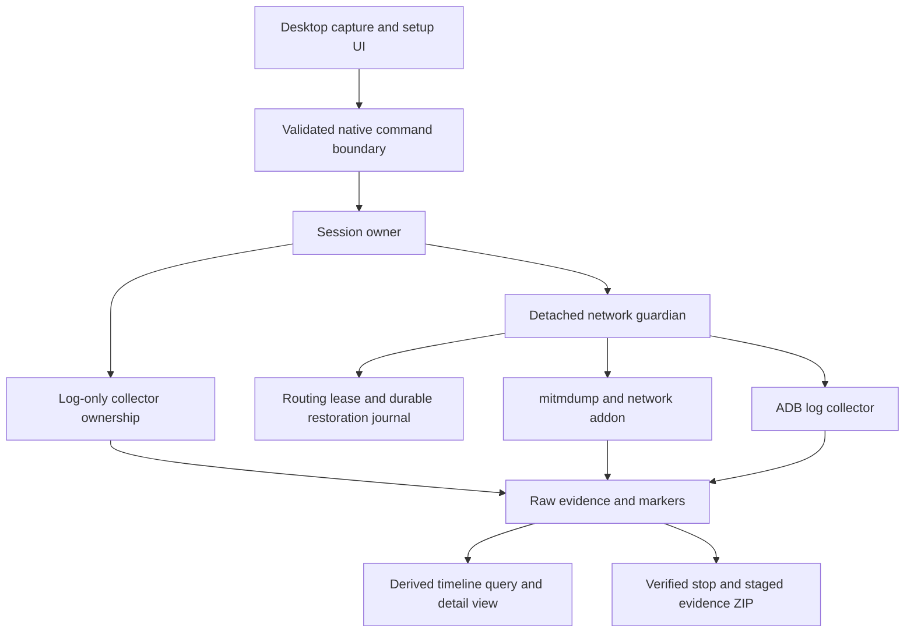

# Android capture architecture grounding

## Overview

The Android product records selected logs and phone HTTP(S), preserves raw evidence, restores the phone connection, and saves an inspectable evidence package. Swift is the behavioral reference. The Tauri tree already provides a native Rust ownership and recovery core on macOS and Windows, but its current frontend and contracts expose a deliberately smaller whole-device prototype. Full Android parity includes setup, app attribution, session inspection, safe save, diagnostics, installation, and updates.

This synthesis describes `/private/tmp/mobile-capture-android-port` at `941074c9`, verified directly. The Swift inventory used `18c47f1`; the Tauri inventory used `73e1210` and confirmed matching baseline files in the merged checkout. No runtime or packaging acceptance was performed for this synthesis. The three inventories are evidence maps, not passing product acceptance reports.

## Key concepts

- **Session evidence** consists of authoritative raw log/network/marker files and persisted metadata. Timeline rows and SQLite caches are derived views. An omitted preview is different from missing evidence.
- **Capture ownership** means holding the routing lease, authenticated control, and original source-process handles. A persisted PID is neither ownership nor permission to terminate a process.
- **Completion** requires restored routing and verified collector shutdown. Successful ZIP creation is separate from complete coverage.
- **App scope** admits Android log bytes only after identity verification. It does not restrict the whole-device network proxy to that app.
- **Setup readiness** distinguishes host prerequisites, copied certificate identity, and fresh observed phone traffic. None implies the others.

## How it works

The diagram shows current Tauri boundaries. Its guardian currently always starts logs with network; Swift independently selects logs, network, or both. Swift defaults to network only and app-scoped logs when logs are selected. Tauri's `CaptureSelection` contains only `Logs` and `LogsAndNetwork`; `CaptureOwner::start` always requires whole-device log consent. These are confirmed gaps, rather than different terminology for the same behavior. See `TauriPoC/capture-core/src/model.rs:148`, `controller.rs:44`, and `Sources/State/CaptureStore.swift:62`.

### Admission and recording

Swift `CaptureStore` owns selection, configuration, operation state, session metadata, polling, and timeline viewport. Lifecycle mutations cross `CaptureRuntimeClient` into the compiled host. The host resolves app identity before changing routing. For app logs, discovery checks the active Android user, unique package UID, installation identity, and supported filtering strategy. `CaptureAndroidLogFilter` continuously verifies identity before queued bytes enter raw evidence. Unknown identity, PID reuse, reinstall, user switch, clock rollback, or excessive verification backlog stops logging with a coverage gap. It never widens to whole-device logging. See `CaptureLogDiscovery.swift:68`, `CaptureAndroidLogFilter.swift:72`, `:143`, and `CaptureCollectorWorker.swift:126` under `Sources/Core`.

Tauri React holds a validated `Snapshot`, local selections, filters, and pending action. It polls every 650 ms and rejects stale poll generations. Zod validates native responses. The adapter serializes owner operations through `Arc<Mutex<CaptureOwner>>` inside `spawn_blocking`. Current start requests send serial and consent, while the adapter inserts default limits. See `TauriPoC/src/main.tsx:72`, `src/api.ts:88`, and `src-tauri/src/lib.rs:33`.

`CaptureOwner` starts a `LogSession` for logs only or launches/attaches the network guardian. The log collector owns ADB through a worker and input lease. The guardian owns the engine, logging worker, routing journal, authenticated endpoint, and completion proof. It starts sources before claiming the phone route. See `TauriPoC/capture-core/src/controller.rs:16`, `owner.rs:76`, and `network/mod.rs:164`.

Swift log budgets stop logs while network continues. Its maxima are 200,000,000 bytes, 250,000 records, and 600 seconds. Tauri's current limits cap at 32 MiB, 100,000 records, and 120 seconds; the guardian also uses log duration to stop the entire session. Its addon admits 32 flows and marks bodies above 256 KiB unavailable. These restrictions currently affect retained evidence, not just UI rendering. See Swift `CaptureLoggingPolicy.swift:3`; Tauri `model.rs:25`, `network/mod.rs:660`, and `resources/network_addon.py:48`, `:126`, `:154`.

### Stop, recovery, and evidence publication

Both implementations treat restoration as a prerequisite to stopping the proxy. Swift journals all five Android global proxy fields and owned ADB reverse mapping, preserves external changes, and explicitly clears Android's cached disabled proxy state before restoring absent or empty values. This last transition is a required behavior beyond rewriting original settings. See `Sources/Core/CaptureLifecycle/AndroidCaptureRouting.swift:30`, `:69`, `:123`.

Tauri recovery can relaunch forwarding when the engine is gone and routing remains owned. `Guardian::stop` restores the route, persists restoration, and only then closes logs and stops the engine. Failed restoration returns a recovery problem while retaining a viable connection path. Export requires `SealedEvidence`, formed from restoration and source-lease proofs. See `TauriPoC/capture-core/src/network/mod.rs:37`, `:365`, `:388`, `:508`; the restoration-before-stop order was checked directly.

Swift save exposes restore, stop collectors, finish timeline, validate, create ZIP, and publish progress. Cancellation becomes admissible after restoration and verified shutdown but before publication. It preserves raw evidence and an existing ZIP. Export stages an allowlist, validates references, normalizes every raw event, hashes exact staged bytes, and publishes. Runtime secrets, control state, and private CA keys stay excluded. See `CaptureSaveCoordinator.swift:16`, `:73` and `CaptureEvidenceExporter.swift:16`, `:63`, `:95` under `Sources/Core`.

Tauri already streams complete admitted raw records into normalized export and checksums, rather than exporting its preview list. Its UI currently returns a local ZIP pathname without the complete save/retry/copy/reveal workflow. A successful archive may still contain explicit omissions or failed coverage. See `TauriPoC/capture-core/src/evidence.rs:58`, `:146`, `:181`, and `src/main.tsx:309`.

### Inspection and reopening

Swift uses one disposable SQLite index per inspected session. Queries are bounded, cursor-based, and tied to an index generation. Full-text matching and selected-event reconstruction read complete underlying data. Pause freezes a display sequence boundary while collection continues; Clear View hides earlier sequences without deleting evidence. Selection and follow preference survive paging. Opening a saved session does not require capture tools. See `NativeTimelineModels.swift:24`, `NativeTimelineStore.swift:290`, `:344`, `:415`, and `CaptureStore.swift:351`, `:947`, `:969`.

Tauri reparses raw files for snapshots and fairly retains 500 preview events across sources. Frontend search covers only that retained array; detail fields and bodies are truncated with no full-detail command. `CaptureOwner::open` reattaches prior network ownership but does not reopen arbitrary saved sessions or recover persisted log-only inspection. See `TauriPoC/capture-core/src/timeline.rs:249`, `:297`, `owner.rs:212`, `controller.rs:16`, and `src/api.ts:131`.

### Setup, Doctor, and delivery

Swift setup owns a separate network-only check store so it cannot replace the user's inspected session. Read-only prerequisite inspection launches no collectors and takes no routing ownership. Certificate preparation copies only bounded validated public PEM to `/sdcard/Download`; installation remains manual. The connection check binds exact decoded HTTPS response, fresh nonce, session, configuration, and current CA. Browser success is distinct from app trust or pinning, and loopback needs phone-origin confirmation. See `CaptureSetupStore.swift:46`, `:289`, `CaptureDevicePreparation.swift:7`, and `CaptureSetupReadiness.swift:264`.

Tauri exposes a certificate path and nonce check URL, but lacks guided setup, certificate transfer, Doctor, and portable task/readiness context. Its packaged resources currently contain worker, guardian, and addon; ADB and mitmdump come from external discovery. Swift has reviewed macOS ARM64 engine and Darwin ADB locks, complete-app integrity checks, public-only setup reporting, and strict JSON Doctor exit behavior. Windows needs independently reviewed payloads and native integrity/architecture checks. See `TauriPoC/src-tauri/tauri.conf.json:31`, `src-tauri/src/tools.rs:89`; `Dependencies/Capture`; `CaptureDoctorCLI.swift:15`, `:117`; and `CaptureDoctor.swift:205`.

The Tauri workflow builds macOS and Windows artifacts and exercises process, evidence, and real loopback checks using a pip-installed engine. It does not establish bundled standalone-engine installation, signed production release, physical Android behavior, or fresh-host acceptance. Swift's signing, notarization, installer, and Sparkle feed are platform-specific reference contracts. They cannot become Android Windows delivery merely by renaming artifacts. Manual update admission must continue to block replacement during capture, save, recovery, setup, Doctor, and another owner. See `.github/workflows/tauri-poc.yml:18`, `Scripts/release.sh:74`, `Scripts/install.sh:43`, and `CaptureUpdateAdmission.swift:5`.

## Where things live

| Area | Entry points |
| --- | --- |
| Android reference behavior | `Sources/State/CaptureStore.swift`, `CaptureSetupStore.swift`, `Sources/UI/CaptureView.swift` |
| Swift ownership and routing | `Sources/Core/CaptureLifecycle/NativeCaptureHost.swift`, `AndroidCaptureRouting.swift` |
| Swift identity and inspection | `Sources/Core/CaptureServices/CaptureAndroidLogFilter.swift`, `Sources/Core/Capture/NativeTimelineStore.swift` |
| Tauri IPC and UI | `TauriPoC/src/api.ts`, `src/main.tsx`, `src-tauri/src/lib.rs` |
| Rust owner and proof boundary | `TauriPoC/capture-core/src/controller.rs`, `owner.rs`, `network/mod.rs`, `network/control.rs` |
| Evidence and processes | `TauriPoC/capture-core/src/timeline.rs`, `evidence.rs`, `worker.rs`, `process.rs`, `lease.rs` |
| Delivery reference | `Dependencies/Capture`, `Scripts/release.sh`, `docs/CAPTURE-DISTRIBUTION.md`, `docs/AGENT_SETUP.md` |

## Gotchas

- Preserve Swift and iPhone as a separate product boundary. Shared reference code and release feeds do not authorize replacing its bundle identity, installer, or Sparkle policy.
- Swift and Tauri share `/tmp/capture-companion-UID/owner.lock` on Mac but have different persisted formats. The common pathname is not proof of safe cross-product recovery. This remains an explicit compatibility verification gap.
- Tauri's private CA path contains `TauriPoC`. Changing product identity or moving that path can rotate effective trust. Existing sessions must finish or recover with their owning app before migration.
- Network coverage needs decoded HTTP, TLS errors, unavailable bodies, incomplete flows, and intentional source absence separately represented. Running processes and event counts do not prove trustworthy observed traffic.
- Windows has substantive Job Object, private ACL, file-lock, executable-name, and no-console branches. Source feasibility and cross-compilation remain different from native installed-package acceptance.

Evidence inventories read in full or targeted portions are `/private/tmp/android-port-swift-inventory.md`, `/private/tmp/android-port-tauri-inventory.md`, and `/private/tmp/android-port-delivery-inventory.md`. Targeted source checks reconciled source-selection, consent, startup reattachment, stop ordering, ownership namespace, and CA-path claims. No contradiction requiring a different architecture was found.
