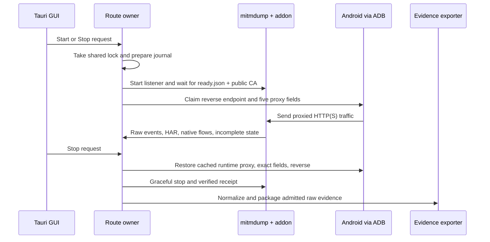

# Android network capture in the Tauri PoC

## Overview

The Tauri PoC currently owns one Android logcat worker inside the GUI process. It has no proxy, Android routing changes, CA setup, network timeline, or network export. Its verified worker receipt protects log export, but it cannot protect a phone that points to a proxy after the GUI exits. Real network capture therefore crosses two existing contracts: the production Android routing and recovery lifecycle, and the schema-1 evidence pipeline built around mitmdump and `CaptureRuntime/network_addon.py`. The PoC's log-only scope was deliberate while portable recovery remained unproven. (`TauriPoC/README.md:1-5,68-84`; `.audit/tauri-poc-design.md`, Problem and Tradeoffs; `TauriPoC/capture-core/src/owner.rs:15-73`.)

The core ordering is listener ready, route claimed, traffic recorded, route restored, collectors stopped and verified, then evidence finalized. A live route owner must outlive GUI close long enough to restore Android routing. A durable journal lets a later process recover after that owner dies; it does not keep the proxy available during the owner's hard crash. (`Sources/Core/CaptureLifecycle/NativeCaptureHost.swift:218-255,279-329`; `NativeCaptureHost.swift:113-149`; `Sources/Core/CaptureLifecycle/CaptureHostProcesses.swift:39-56`.)

## Key concepts

- **Route owner and lease.** Production `CaptureRoutingLease` takes a per-user `flock` at `/tmp/capture-companion-<uid>/owner.lock`, shared with the legacy runtime across session roots. It checks the previous session before admitting a new one. The PoC has no equivalent; its private session root alone cannot exclude another process from changing the same phone. (`CaptureLifecycleFiles.swift:50-85`; `TauriPoC/capture-core/src/owner.rs:91-175`.)
- **Routing journal.** `AndroidCaptureRoutingJournal` stores the selected device, ADB path, endpoint, exact previous and applied values for five global proxy keys, and write-ahead mutation flags. `CaptureLifecycleFiles.write` flushes a private temporary file, renames it, and syncs the directory. (`AndroidCaptureRouting.swift:13-28,31-66`; `CaptureLifecycleFiles.swift:33-47`.)
- **Network engine.** Production starts real `mitmdump` with a private CA directory, `-w network/capture.mitm`, and `-s CaptureRuntime/network_addon.py`. Mitmdump owns TLS interception and the native flow file; the addon emits JSONL, HAR, incomplete-flow state, and readiness. The installed macOS engine is mitmproxy 12.2.3. (`NativeCaptureHost.swift:279-320`; `network_addon.py:15-22,59-83,142-190`; `docs/CAPTURE-DISTRIBUTION.md:69-114`.)
- **Canonical evidence.** The addon event ID and `network/capture.mitm#<flow-id>` pointer are raw source data. The normalizer creates stable `event-<hash>` IDs from source, path, one-based line, and raw bytes; its public `raw_ref` points to `network/events.jsonl#L<n>`. The original addon ID and native pointer remain in detail. (`CaptureRuntime/evidence.py:158-205,227-265`; `docs/CAPTURE-PACKAGE.md:154-193`.)

## How it works

1. Production starts an independent supervisor and takes the shared routing lease before preparation. It starts `mitmdump` on loopback, waits up to 25 seconds for the addon's `network/ready.json`, and confirms the public CA certificate before changing the phone. `running()` creates readiness and initial HAR/incomplete state; the setup probe is nonce bound and proves only that browser path, not coverage of every app or SDK. Android CA trust is a separate setup concern. (`NativeCaptureHost.swift:5-60,152-177,279-329`; `network_addon.py:24-62`; `docs/CAPTURE-DISTRIBUTION.md:25-32`.)
2. Android `claim` snapshots presence and exact string values for `http_proxy`, `global_http_proxy_host`, `global_http_proxy_port`, `global_http_proxy_exclusion_list`, and `global_proxy_pac_url`. It refuses an occupied `tcp:<port>` reverse endpoint, journals intent before `adb reverse --no-rebind` and before proxy writes, then verifies the whole applied snapshot. A selected-device `adb -s` scopes every command. (`AndroidCaptureRouting.swift:31-66,104-111,159-176`.)
3. The addon emits separate request and response records, plus error and TLS failure records. It retains original headers and bodies when available; binary bodies use base64. `raw_content is None` means unavailable, not empty, and appears in event detail, HAR, and `network/incomplete.json`. Mitmdump's `-w` option writes `capture.mitm`; the addon does not. `done()` flushes remaining pending entries after the event loop exits. (`network_addon.py:64-83,90-104,106-190`; `NativeCaptureHost.swift:280-308`.)
4. On Stop, the supervisor first records a new recovery attempt and restores routing while its proxy worker remains alive. If the original global proxy was disabled, restoration writes `http_proxy=:0` and waits for the normalized cleared five-key vector. A retry can pass through an empty value before another `:0` write to force Android's notification. It then restores the original values exactly, checks the result, removes only its own same-to-same reverse mapping, and marks the journal restored. Values changed externally are preserved and reported as conflicts. (`NativeCaptureHost.swift:218-255`; `AndroidCaptureRouting.swift:69-101,123-156`.)
5. Restoration failure keeps the living supervisor's routing lock and proxy lease, and a later authenticated Stop retries. After successful restoration, the supervisor closes workers, verifies shutdown receipts, drains the final timeline, and exports. If the supervisor is gone, recovery first acquires the same lease, uses the journal's device and ADB path, waits for receipts, and marks interrupted evidence. It does not signal a saved PID. A hard-killed supervisor can leave a period with no proxy listener before later recovery. (`NativeCaptureHost.swift:113-149,218-255,363-379`; `NativeCaptureRouting.swift:64-68`; `CaptureHostProcesses.swift:39-56`.)
6. Schema 1 admits six optional raw files: `logs/device.log`, four `network/*` evidence files, and `timeline/markers.jsonl`. It adds a complete normalized timeline, manifest, context, README, and checksums. Runtime state, CA keys, `ready.json`, and the routing journal stay outside the ZIP. Export must use the owner's actual `routing_restored` result and report partial coverage for missing artifacts, pending flows, errors, missing bodies, or unverified shutdown. A TLS failure alone does not count as decoded HTTP observation. (`docs/CAPTURE-PACKAGE.md:16-99`; `NativeCaptureHost.swift:400-476`; `CaptureEvidenceExporter.swift:13-93`.)

## Where things live

- `Sources/Core/CaptureLifecycle/AndroidCaptureRouting.swift`, `CaptureLifecycleFiles.swift`, `NativeCaptureHost.swift`, and `CaptureHostProcesses.swift` show the proven macOS ownership, route, stop, and recovery order. The Swift/Darwin code is a behavior reference, not portable implementation code.
- `CaptureRuntime/network_addon.py` and `CaptureRuntime/evidence.py` define raw network output and canonical schema-1 normalization. `docs/CAPTURE-PACKAGE.md` defines package membership and completeness.
- `TauriPoC/capture-core/src/owner.rs`, `process.rs`, `worker.rs`, `timeline.rs`, `evidence.rs`, and `files.rs` contain the current log-only Rust owner, bounded worker, normalizer, exporter, and file guards. `TauriPoC/src-tauri/src/lib.rs`, `src/api.ts`, and `src/main.tsx` expose that state to the GUI.
- `TauriPoC/scripts/prepare-worker.mjs` and `src-tauri/tauri.conf.json` package only the Rust log worker today. The existing mitmproxy distribution lock covers macOS arm64, not a Windows engine payload. (`docs/CAPTURE-DISTRIBUTION.md:69-114,174-191`.)

## Gotchas and unresolved boundaries

- The GUI stores `CaptureOwner` in Tauri state and calls `stop()` on close or exit. Its `Lease::drop` closes the worker's only stdin lease; Windows holds a kill-on-close Job inside that GUI-owned lease. Placing a live proxy or route guardian in that Job could kill it before Android routing is restored. A network route owner needs a lifetime and retry path independent of GUI close; the concrete executable and cross-platform process contract remain design decisions. (`TauriPoC/src-tauri/src/lib.rs:82-107`; `capture-core/src/owner.rs:15-73`; `capture-core/src/process.rs:105-149`.)
- A prior Pixel 4a Android 13 run restored settings database values but left ConnectivityService probing the closed capture port. The explicit `:0` acknowledgment fixed Wi-Fi validation; a later physical Start/Stop verified exact originally unset values and no reverse tunnel. This is why a database snapshot match alone is insufficient. (`docs/CAPTURE-PROOF.md:62-93`; `CaptureRuntime/capture_runtime.py:259-298`.)
- The current Rust exporter hard-codes `capture_network=false`, `network=not_selected`, and `routing_restored=true`; the UI and Zod contract exclude network. The Rust reader also loads each file into memory and rejects files above 34 MiB, whereas schema 1 retains full raw bodies. Network export needs an explicit storage/admission rule and honest completeness reporting; a log cap must not silently truncate HTTP evidence. (`TauriPoC/capture-core/src/evidence.rs:20-72`; `timeline.rs:16-22`; `files.rs:8-29`; `TauriPoC/src/api.ts:14-24`.)
- Python's `finalize_package` reads `incomplete.json` pending IDs but does not mark `missing_bodies` alone partial. Native Swift does. The latter matches the addon's explicit unavailable-body marker and is the stricter coverage claim. This is a real contract difference, not an investigator conflict. (`CaptureRuntime/evidence.py:408-445`; `NativeCaptureHost.swift:473-476`; `network_addon.py:90-104`.)
- Windows still needs a pinned engine payload, license and packaging checks, a guardian lifetime, and a cross-process routing exclusion rule. The macOS lock must continue to exclude the production and legacy owners. The expected result after a guardian hard crash also needs an explicit recovery promise; existing tests prove later journal recovery, not uninterrupted proxy availability. (`docs/CAPTURE-DISTRIBUTION.md:69-114`; `CaptureLifecycleFiles.swift:50-85`; `Tests/NativeCaptureLifecycleTests.swift:588-667`.)
